Animbits User Documentation
###########################

Tools for animators.

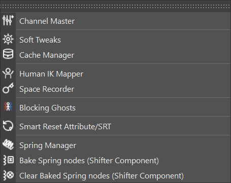

Channel Master
==============

Channel Master is an alternative ChannelBox, but allowing the user to create custom configurations and store it.

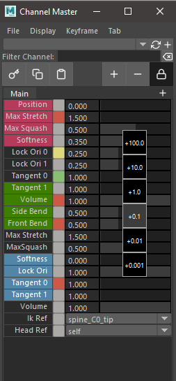

The configuration is stored in a persistent node in the scene. The data can be exported and imported.

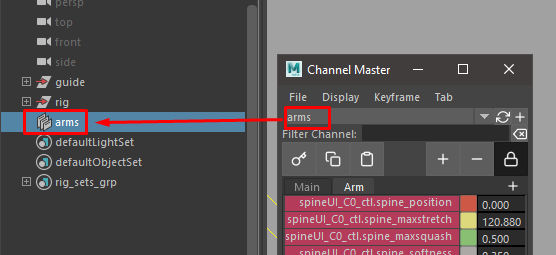

The channels can be a mix from different objects. The only rule is that the object that contains the channel and the channel master node should be in the same namespace.

However the  internal data is not stored with name spaces, so the same configuration can be re-used in different name spaces.

The Main tab works like  the regular ChannelBox and the data is rebuild on the flight. The advantage is that is possible to lock the content using the lock icon. Also create a node is not required to use the main tab

To create custom configuration, require a custom node.

.. warning::
	Custom configurations needs to be saved. If to be stored in the node. Missing to save the new configuration will  revert the channel configuration to the previous state when the node is refresh or change node in the drop-down menu

.. warning::
	The tool has been design to avoid bottleneck the evaluation while playback by turning off the refresh and updating on demand in some situations.
	When scrubbing the timeline still updating the channel values. This will take some FPS away (Only when Scrubbing, not in Playback).

	If you need to do scrubbing a lot and need the performance. You can change the Channel Master to empty Main tab, by lock the tab when nothing is selected. Or Just close Channel Master

	We planning to add more control over this in the future.

**File Menu:**

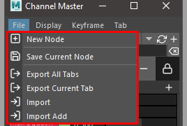

* **New Node:** Creates a new node

Also is possible  to add nodes from the node bar in the UI

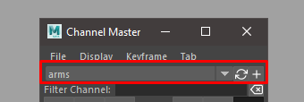

* **Save Current Node:** Save the current node configuration
* **Export All Tabs:** Export the current node configuration to a Json file
* **Export Current Tab:** Export current tab configuration to Json file
* **Import:** Import and create a new node
* **Import Add:** Import and add the configuration to an existing node

**Display Menu:**

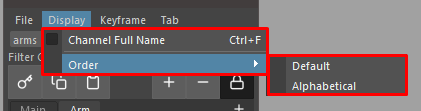

* **Channel Full Name:** Display the full name of the channel

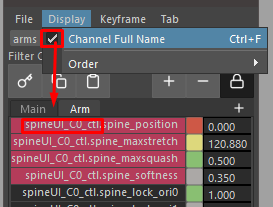

* **Order:** Arrange the channels by Alphabetic or Default order

**Keyframe Menu:**

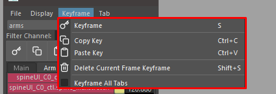

* **Keyframe:** Toggle a keyframe for all the channels in the current tab. If there is a channel that doesn't have keyframe will add keyframe. If all channels have keyframe it will remove the keyframe.
* **Copy key:** Copy current values in the buffer
* **Paste key:** Paste from buffer and set keyframe
* **Delete current keyframe:** Delete the current tab keyframe
* **Keyframe all tabs:** Keyframe command will be applied to all tabs. With this option active the toggle functionality will change to always key.

**Tabs Menu:**

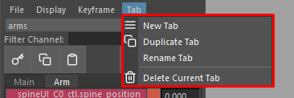

* **New Tab:** Create new tab.
* **Duplicate Tab:** Duplicate current Tab
* **Rename Tab:** Rename current tab
* **Delete Current Tab:** Delete current Tab

Tabs can be added using the + icon in the tabs row

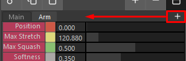

Channels
--------

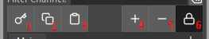

1) **Keyframe button:** Same command as keyframe menu
2) **Copy key button:** Same command as keyframe menu
3) **Copy paste button:** Same command as keyframe menu
4) **Plus Button:** Add selected channels from ChannelBox to Channel Master
5) **Minus Button:** Remove SelecteT channels
6) **Lock refresh:** in Main Tab

**Search channel:** will filter the channel list

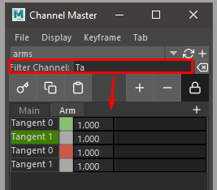

**In the channels area we will find 2 context menus and a middle click slider precision widget.**

**Channel context menu:**  The actions in this menu can be apply to multiple selection

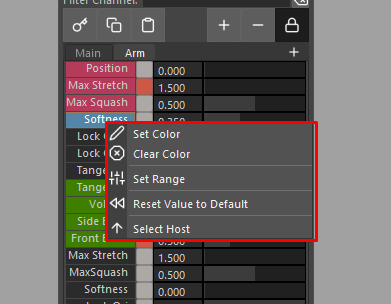

* **Set Color:** Set a custom color for easy identification.
* **Clear Color:** Clear custom color.
* **Set Range:** Set range min and max for the slider.
* **Reset Value to Default:** Reset the channel value.
* **Select Host:** Select the object that owns the channel.

**Keyframe channel button context menu.:**

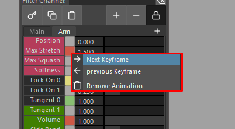

* **Next Keyframe:** Move time to the next keyframe.
* **Previous Keyframe:** Move time to the previous keyframe.
* **Remove Animation:** Delete channel animation.

**Keyframe button color coding:**

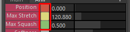

* **Red:** Keyframe in the current frame.
* **Green:** Animation but not keyframe in the current frame.
* **Yellow:** Current value changed.

**The slider precision** widget is similar to the one from Houdini

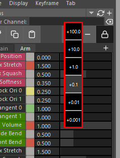

Soft Tweaks
===========

This tool create and manage SoftTweaks (ST for short) and also provide as simple API to import and export configurations, so is possible to integrate with your pipeline and animation publishing system.

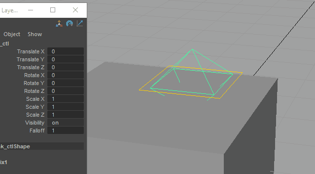

SoftTweak is a dynamic position tweak using softmod deformer
The credit of the idea goes to `Vasil Shotarov <http://bindpose.com/help-animators-fix-intersections-softmod-deformer/>`_ , thanks!

The SoftTweak have 2 controls. The Base represents the bind position where the ST will not have any effect. The main control will trigger the deformation when is not in the reset position..

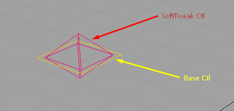

In the ST main control we can find a falloff channel to control the area of deformation

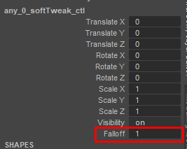

SoftTweak Manager GUI
---------------------

By default the SoftTweak is design to be used by shot and not part of a rig. However if is needed to publish a rig with some SoftTweaks there is an option to flag (is_asset_softTweak) the SoftTweak as asset tweak. So the tool will make a distinction between the ones that need to be publish with the shot and the ones that are included in the asset.

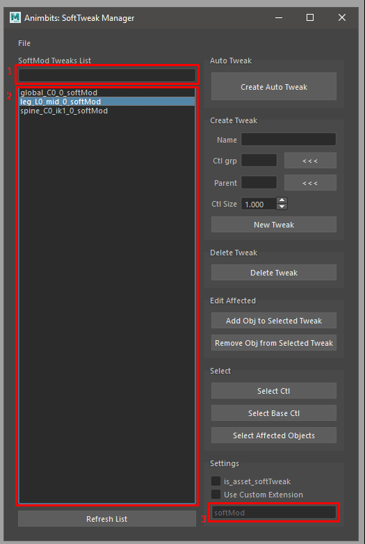

**File Menu:**

* **Export Selected:** Exports selected ST from the list
* **Export All:** Exports all the ST from the list. If search filter is used, will not affect the export. But export will make a distinction between regular SoftTweak and  asset SoftTweak
* **Import:** Import ST configuration from a file.

**GUI:**

* **Search Filter:** (1) Quick search filter of the SoftTweak list.
* **SoftTweaks List:** (2) ST selection list.
* **Create Auto Tweak:** Create a tweak based on the current selection.

	1. Select the objects to apply the ST
	2. Last element selected should be a control. This will be the parent of the ST. Also the ST will take the Name and the group(set) from the parent
	3. Click Crete Auto Tweak

* **Name:** Name of the new ST.
* **Ctl grp:** Group of controls to add the new ST controls.
* **Parent:** Parent of the new ST.
* **Ctl Size:** Parent of the new ST.
* **New Tweak:** Create a new ST.
* **Delete Tweak:** Delete the tweaks selected in the ST list.
* **Add Object to Selected Tweak:** Add selected objects to the tweaks selected in the ST list.
* **Remove Object from Selected Tweak:** Remove selected objects from the tweaks selected in the ST list.
* **Select Ctl:** Select the control from the tweaks selected in the ST list.
* **Select Base Ctl:** Select the Base control from the tweaks selected in the ST list.
* **Select Affected Objects:** Select the object affected by the the tweaks selected in the ST list.
* **is_asset_softTweak:** Tag the new created ST as an asset ST. This will also change the ST selection list to show the asset ST.
* **Use Custom Extension:** The new ST will have a custom suffix.
* **Suffix Name:** (3) Suffix name for the new ST.

API
-----

.. code-block:: python

	# To import a softTweak configuration from script editor or Shifter Custom Step:

	from mgear.animbits import softTweaks as st
	st.importConfigurationFromFile(filePath= path to the .smt configuration file)

	# to export configuration
	# list the softtweaks in the scene
	softtweaks = st._listSoftModTweaks(is_asset=False)
	# export
	st.exportConfiguration(softtweaks)

Smart Reset Attribute/SRT
=========================

Puts the selected controls back to their default values in one click, for example to return a control to its neutral pose while posing.

**How it decides what to reset:**

* **Channels highlighted in the Channel Box** - Only those channels are reset, on every selected object. Use it to reset a single custom attribute (for example a ``blend`` or ``roll`` channel) without touching the transforms.
* **Nothing highlighted** - The transforms are reset: translate, rotate and scale, plus visibility. The rotate order is reset too, but only on Shifter controls that store their original rotate order; on other nodes it is left as it is, and a message says so.

**Values:** each channel goes back to its Maya default value: 0 for translate and rotate, 1 for scale and visibility, and the default value set when a custom attribute was created. It is not a stored pose: a control whose neutral pose is not at its default values goes to its default values.

**Notes:**

* Locked or connected channels are skipped without error.
* No key is set. On animated channels the reset value lasts until the time changes: key it to keep it.
* Works on any number of selected objects; channels that an object doesn't have are skipped.

**TIP:** Set a hotkey for this command using mGear Hotkey creator in utilities menu.

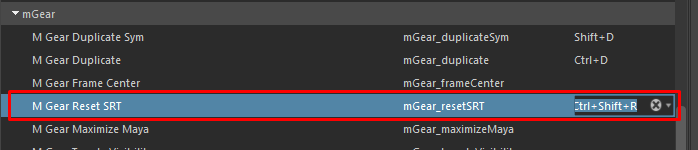

Cache Manager
=============

Swaps heavy rigs for a lightweight GPU cache of their geometry, so scenes with many characters play fast in the viewport. When you need to animate a rig again, one click brings it back.

**How it works:** the animated geometry of a rig is written to an Alembic file (``.abc``) with Maya's GPU cache, over the playback range. A ``gpuCache`` node named ``<rig>_cache`` shows that file in the viewport, and the rig itself is unloaded or hidden, so Maya no longer evaluates it.

**Requirements:**

* Rigs are found by their ``is_rig`` attribute (every Shifter rig has it). Studios can use another attribute with the ``MGEAR_CACHE_MANAGER_RIG_ATTRIBUTE`` environment variable.
* The rigs should be **referenced**: unloading is done on the reference.
* The **Model group** must be set: the group of the rig that holds the meshes to cache.

**Options** (saved in your preferences, ``<Maya app dir>/mGear/animbits_cache_manager.json``):

* **Rig switch** - What happens to the rig once cached: **Unload** its reference (default, lightest) or **Hide** it.
* **Model group** - Name of the group holding the meshes, without namespace (for example ``model``). Select the group and click **Set**, or type it and click **Set**. It is searched under each rig, so the same name works for every character.
* **GPU path** - Folder where the cache files are written (**...** to browse). Default: the ``MGEAR_CACHE_MANAGER_CACHE_DESTINATION`` environment variable, otherwise the temp folder.
* **Display type** - **Current** keeps the meshes' own look; **Color** shades the whole cache with the color you pick, to tell cached characters apart.

**Main window:**

* **Filter** - Type to filter the rig list.
* **Rig list** - The rigs of the scene. A cache icon marks the cached ones. Multiple selection is allowed.
* **Cache Selected** - Caches the selected rigs over the playback range, then unloads or hides them. Rigs that are already cached are skipped.
* **Set Rig** - Brings the selected cached rigs back: the reference is reloaded (or the rig shown again), the ``gpuCache`` node is removed and **its cache file is deleted from disk**.

**Notes:**

* The cache is a snapshot: after changing the animation, **Set Rig** and cache again.
* Each cache file name includes the date and time, so caches never overwrite each other.
* **Color** display uses a temporary Render Setup layer while caching: **existing Render Setup layers of the scene are removed**. Use **Current** in scenes that use Render Setup.
* The list refreshes by itself when a scene is opened or created.

HumanIK Mapper
==============

Drives an mGear rig with motion capture through Maya HumanIK, and bakes the mocap onto the rig controls, one file at a time or in batch.

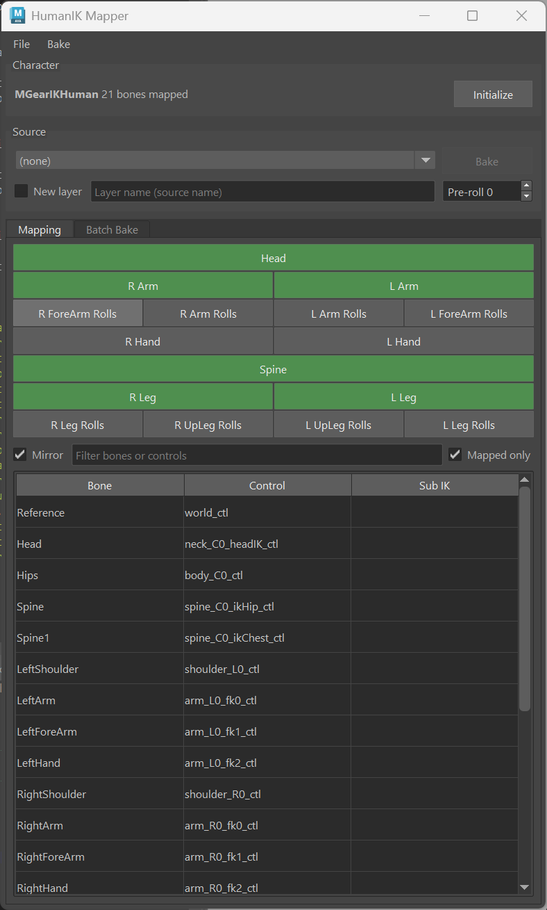

**How it works:** the tool builds a HumanIK character definition, ``MGearIKHuman``, whose "bones" are the rig **controls** you pick for each body part. Any HumanIK character in the scene (mocap, another character) can then drive the rig as its **Source**, and be baked onto the controls. Everything is done from this window: Maya's HumanIK window is not needed (**File > Open HumanIK Window** opens it for advanced settings). The ``mayaHIK`` plug-in is loaded when the tool opens, ``fbxmaya`` when FBX files are batch baked.

Character
---------

1. Pose the rig in a stance HumanIK accepts (usually a T-pose), with the FK controls you want to drive.
2. Select the root control (for example ``world_ctl`` or the body root) and click **Initialize**. This creates ``MGearIKHuman`` and maps the selection as the **Reference**. If the character already exists, Initialize only sets its Reference.

The label shows the character and how many bones are mapped.

Mapping tab
-----------

* **Body part buttons** - **Head**, **Spine**, **R/L Arm**, **R/L Hand**, **R/L Leg** and the roll buttons. Their color shows the mapping state: **green** complete, **orange** partial, grey nothing mapped. The tooltip lists each bone and its control; bones marked ``*`` are required by HumanIK (Hips, Spine, Head, and the upper leg, leg, foot, arm, forearm and hand of each side). The others (Shoulder, ToeBase, the extra spine and neck joints, fingers, rolls) are optional.
* Click a button to open its **Map** dialog: it lists the bones of the part in order (for example *Shoulder, Arm, ForeArm, Hand*), with the required ones in bold. Select the matching controls **in that order** in the viewport: the dialog pairs each bone with a control as you select, before anything is mapped. Select fewer controls to skip the last bones. Warnings show extra controls, required bones left without a control, and missing opposite controls. Click **Apply** to map the pairs (one undo).
* **Mirror** - Mapping one side also maps the other side to the opposite controls, found with the mGear left/right naming. Mirrored pairs are shown in italic; a bone without opposite control is left unmapped and reported.
* If a control has locked or connected translate, rotate or scale channels, you are asked to unlock them when mapping or baking: HumanIK needs to drive them. Cancel to leave the rig unchanged.

**Mapping table** - Every HumanIK bone with its control and Sub IK controls; unmapped bones are grey. Type in the filter to find a bone or control, and check **Mapped only** to hide the unmapped bones. Double-click a row to select its controls. Right-click for:

* **Select Controls** - Select the controls of the selected rows.
* **Map Selected Control** - Map the selected control to the row's bone.
* **Unmap** - Remove the controls of the selected rows from the definition.
* **Set Selection as Sub IK** / **Clear Sub IK** - Sub IK controls are extra controls that follow a mapped control during the bake, for rigs where one HumanIK bone should drive more than one control (for example an IK control following the mapped FK hand). They keep their offset to the mapped control, and only their free channels are constrained and baked. With **Mirror** on, the opposite controls are linked too.

The table and buttons refresh after each action, on undo and redo, and when a scene is opened or created. Use **File > Refresh** after editing the definition in the HumanIK window.

**File menu** - **Export Mapping** / **Import Mapping** save and load the mapping as a ``.hikm`` file (bone, control and Sub IK controls). Control names are saved without namespace. On import, the controls are found in the namespace of the selection: select any control of the target rig first. Without selection, a control is found in any namespace when its name is unique. Controls that are missing or found in several namespaces are skipped with a warning. Files saved by older versions of the tool are read too.

Source and Bake
---------------

* **Source** - The HumanIK character driving the rig: any other HumanIK character in the scene (the list refreshes when you open it), or **(none)**. Both definitions are locked when a source is set. If the rig is missing bones HumanIK requires, a warning tells which body parts to complete.
* **Bake** (button or **Bake > Bake**) - Bake the source onto the mapped and Sub IK controls over the playback range. With **New layer**, the keys go to a new override animation layer named in the field (or after the source), and the base layer keeps its animation; otherwise the keys go to the base layer. The bake is one undo, and the source is disconnected afterwards, as with HumanIK's bake.
* **Pre-roll** - Frames evaluated before the playback start, without keys, to let the first frames settle.
* **Bake > Bake to Timeline** - Bake, then move the keys into a **Time Editor** clip on a new track, named after the source.

Batch Bake tab
--------------

Bakes several animation files onto the rig in one go, in order, with a progress bar (press **Esc** to stop after the current file).

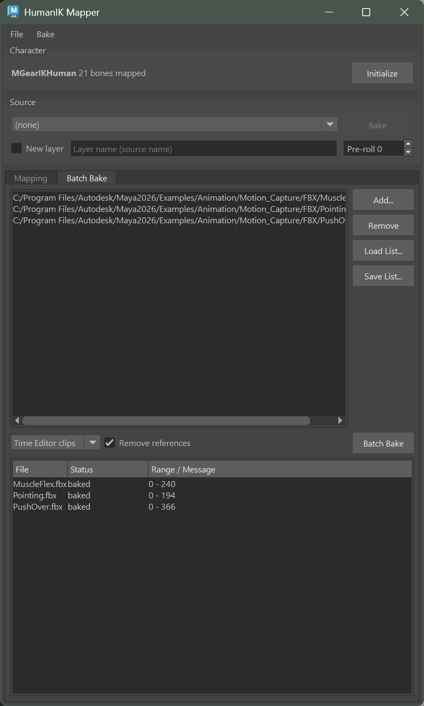

* **Add...** / **Remove** - Add ``.fbx``, ``.ma`` or ``.mb`` files (each with a HumanIK character) or remove the selected ones. **Load List...** / **Save List...** read and write the file list (``.bkcn``).
* Each file is referenced in its own namespace, its HumanIK character is set as the source, and it is baked over **its own frame range** (from its keys; the playback range when it has none), with the **Pre-roll** of the Source section.
* **Layer per file** - Each file is baked on its own override animation layer, named after the file. Use it to compare takes.
* **Time Editor clips** - Each file becomes a Time Editor clip on a new track, each clip starting right after the previous one; the playback range is set to cover them all. Use it to assemble a sequence.
* **Remove references** - Remove each file's reference after its bake.
* The report lists each file with its result: baked (with the frame range), skipped (no HumanIK character in the file) or error.

**Notes:**

* The scene is not saved by the batch bake.
* The mapping is not checked against the rig's IK/FK state: map and bake the controls you want animated (usually FK).

Space Recorder
==============

Records where objects are in the world over the timeline, and puts them back there later, even after the hierarchy, the parent or the space switch changed. Typical uses: change a control's space switch (for example a hand from world to chest) without the hand moving, or copy the motion of one object onto another, without constraints.

**Window:** three buffers, **A**, **B** and **C**, each with:

* **Record Buffer** - Stores the world position, rotation and scale of each selected object on every frame of the playback range.
* **Apply Buffer** - Puts the recorded objects back at their recorded world positions on every frame of the playback range, and keys them.
* **Apply Sel Buffer** - Applies the recording to the **current selection** instead: the first selected object gets the first recorded object's motion, the second the second, and so on (by selection order, not by name).

**Workflow (space switch without pop):**

1. Set the playback range to the frames to fix.
2. Select the controls and click **Record Buffer A**.
3. Change the space switch (or reparent, or edit the parents' animation).
4. Click **Apply Buffer A**: the controls are keyed on every frame so they stay where they were in the world.

**Notes:**

* Keep the same playback range for recording and applying.
* Applying keys **every frame**, on all keyable channels of the objects: simplify the curves afterwards if you need sparse keys.
* For **Apply Sel Buffer**, select at most as many objects as were recorded, in the same order.
* Buffers live in memory: they are cleared when the window is closed or reopened, and not saved with the scene.

Blocking Ghosts
===============

See your key poses side by side while you block. Blocking Ghosts creates static, semi-transparent copies ("ghosts") of the character at the keyframes of the controls you choose, and keeps them in step with the timeline and the camera.

.. image:: images/animbits/Blocking_ghosts.gif
    :align: center

**Key Features:**

* Ghosts at every keyframe of a set of watched controls inside a frame range, including the pose on the current frame
* New, deleted or moved keys are picked up automatically when you move the timeline
* Previous ghosts and next ghosts get their own color; the ghost on the current frame is hidden, since the live rig already shows that pose
* Spread the ghosts sideways along the camera's right axis so overlapping poses can be read, following the camera as you tumble; positive or negative spacing picks which side the previous poses go
* Click a ghost to jump to its frame; your rig selection is kept
* When you change a pose and move on, its ghost is updated from the new pose
* Switch between the ghost colors and the character's own shaders (multi-material meshes included)
* Works with referenced, namespaced rigs

**Workflow:**

1. Add the character meshes to **Objects to ghost** (select them, then **Add Selected**)
2. Add the controls whose keys define the poses to **Watch controls**
3. Set the **Frame range**, or click **Timeline** to use the timeline's playback range
4. Click **Generate**
5. Scrub or click ghosts to move between poses; adjust **Transparency**, **Spacing** and **Shading** at any time
6. Click **Clear** to remove the ghosts

**Options:**

.. image:: images/animbits/Blocking_ghosts_UI.png
    :align: center
    :scale: 50%

* **Frame range** - Start and end frame. Every key of the watched controls in this range gets a ghost. More than 30 poses asks for confirmation first.
* **Timeline** - Set the frame range to the timeline's playback range
* **Previous color / Post color** - Colors of the ghosts before and after the current frame
* **Transparency** - Ghost transparency, from opaque (0) to clear (1). Applies to **Pre / Post Color** shading only.
* **Spacing** - Distance between poses along the camera's right axis, in world units. 0 keeps every ghost in place. Positive values place previous poses on the right and next poses on the left; negative values swap them.
* **Shading** - **Pre / Post Color** or **Original Shader**

**Menus:**

* **File Menu** - Export / Import configurations (``.bgh``; ``.json`` files are also accepted) and a list of recent configurations

**Notes:**

* When you add, delete or move a key of a watched control inside the frame range, the ghosts are updated the next time you move the timeline (once it stops).
* **Original Shader** shows the character's own materials, so the transparency slider is disabled in that mode.
* Ghosts are hidden while the timeline plays.
* Ghosts are never saved with the scene, and nothing the tool does goes into the undo queue, so **Ctrl+Z** only undoes your own edits. To remove ghosts, use **Clear**.
* Closing the window, opening a scene or creating a new scene removes the ghosts.

Spring Manager
==============

Add spring dynamics to animation controls for secondary motion: tails, antennas, hair, ears, cloth pieces or any control that should follow the animation with overlap and jiggle. The springs are live in the scene and are baked to keys when the animation is final.

The Spring Manager works on any animation control. It is not related to the Shifter spring components (see `Bake/Clear Spring Nodes`_ for those).

**Workflow:**

1. Select the controls and press a direction button in the **Create** section. **Auto** aims each spring along the chain: towards the first child, or away from the parent for the last control.
2. Play the animation. Select springs in the viewport or in the **Springs** list and tune them in the **Parameters** section.
3. Save the setup as a preset to reuse it on other shots or characters.
4. **Springs > Bake Selected / Bake All** to convert the dynamics to keys.

The control animation is moved to a spring root node while the spring is active, and given back to the control when the spring is deleted. Every create, edit, bake and delete is a single undo step.

Solver
------

The **Solver** menu lists the spring solvers:

* **Classic** - The mGear spring (``mgear_springNode``) included with mGear. One independent spring per control.
* **Classic Gravity** - The Classic spring with gravity, sphere colliders and a ground (``mgear_springGravityNode``, included with mGear). See `Classic Gravity`_.
* **Bone Dynamics** - Chain springs using the optional boneDynamicsNode plug-in: gravity, wind, angle limits, target pose and branching. See `Bone Dynamics (optional)`_.

Solvers that need a plug-in that is not installed are shown disabled. The **Create** section shows the options of the selected solver, and a **Solver** section shows its scene-wide settings when it has some.

Create
------

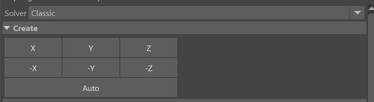

* **X, Y, Z, -X, -Y, -Z** - Create springs on the selected controls, aiming along that axis of each control.
* **Auto** - Find the direction of each control from its chain.

New springs use the values shown in the **Parameters** section when no spring is selected. Controls that already have a spring, or with locked translate and rotate, are skipped.

Springs
-------

Lists the springs of the scene, with their solver and state. Type in the filter field to show only the matching springs (case insensitive, ``*`` wildcard). Drag the bar under the list to make it taller or shorter; the height is remembered. The list and the Maya selection follow each other: selecting a control selects its spring row, and selecting rows selects the controls.

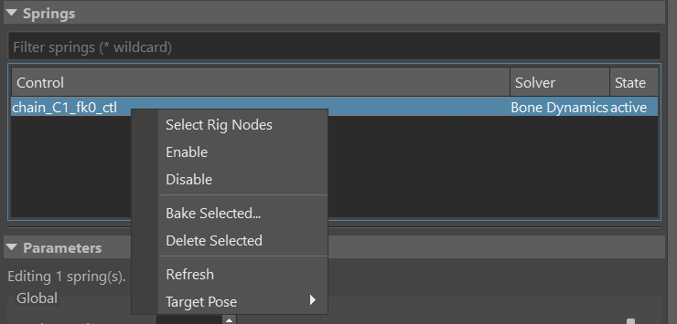

Right-click a spring for: **Select Rig Nodes**, **Enable** / **Disable** (total intensity 1 or 0), **Bake Selected...**, **Delete Selected** and **Refresh**. Bone Dynamics springs also have the **Target Pose** submenu (see `Bone Dynamics (optional)`_). The list updates by itself after the tool's actions, undo, redo and scene changes; use **Refresh** after creating or deleting springs outside the tool (for example deleting nodes in the Outliner).

Springs made by the Spring Manager of mGear 5.3 and older are listed as **Legacy**. They can be baked or deleted, but not edited: delete and create them again to edit them.

Parameters
----------

Edits the selected springs live. When the selected springs have different values, the field shows **—**; editing it sets the value on all of them. A slider drag is one undo step. If a parameter is animated, editing it sets a key at the current frame. The parameters are also on the control, in the Channel Box, so they can be keyed. Hover a parameter for what it does and typical values.

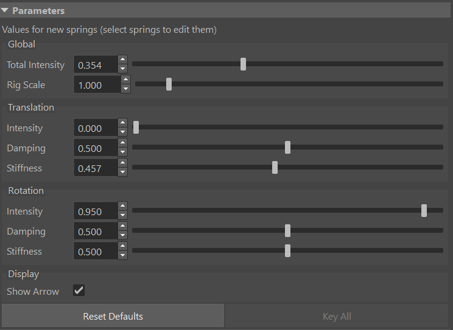

With no spring selected, the panel shows the values used for new springs.

* **Total Intensity** (0-1) - Overall spring effect. 0 follows the animation exactly.
* **Rig Scale** (0-100) - Distance between the control and the spring goal. Increase it on big rigs.
* **Translation Intensity / Damping / Stiffness** (0-1) - Position spring: how much the control lags in position, how fast the motion dies out, and how strongly it is pulled back.
* **Rotation Intensity / Damping / Stiffness** (0-1) - Direction spring: same, for the rotation.
* **Show Arrow** - Display the template arrow showing the spring direction. A display setting: it is not keyed by **Key All** and not copied by values presets.

**Reset Defaults** restores the default values. **Key All** keys every parameter of the selected springs.

Presets
-------

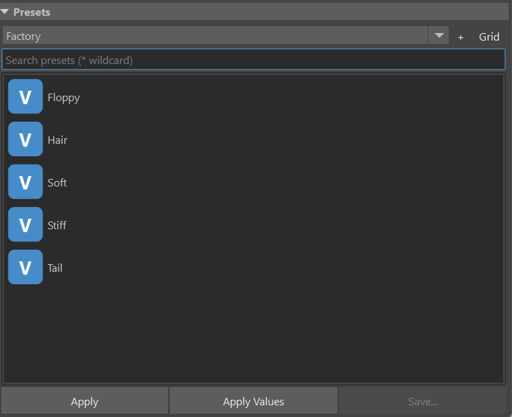

Presets are ``.spg`` files. There are two types, shown with a colored badge, in the tooltip and in the details under the list:

* **Values presets** (blue **V**) - Only the parameter values, not tied to any control. They work on any spring of any character: use them for reusable looks such as *Soft*, *Stiff* or *Tail*. The Factory presets are values presets.
* **Rig presets** (orange **R**) - The springs of a character: the control names (without namespace), the direction and the values of each spring. They recreate that exact setup on the same character, in any namespace: use them to save and share a character's spring setup.

Choose the library in the menu:

* **Factory** - Values presets included with mGear: Soft, Stiff, Floppy, Tail and Hair for Classic, Gravity Light and Gravity Hanging for Classic Gravity, and the Chain presets for Bone Dynamics. Read only.
* **User** - Your presets, in ``<Maya user prefs>/mGear/spring_presets``. The folder is created when you save the first preset.
* **Custom folders** - Add shared folders with **+** or **Presets > Add Library Folder**.

**Grid** shows the presets as a thumbnail grid. Selecting a preset shows its thumbnail, type, description and contents under the list. The search field filters the list (case insensitive, ``*`` wildcard).

**Save...** opens the save dialog:

* **Name** and **Description**.
* **Type** - **Values** saves the values of the first selected spring, or the values for new springs when no spring is selected. **Rig** saves the selected springs (only available when springs are selected).
* **Thumbnail** - Captured from the active viewport when the dialog opens. **Viewport** captures it again, **Capture Region...** lets you drag a rectangle anywhere on the screen, and **Clear** saves the preset without image. The thumbnail is saved as a ``.png`` next to the ``.spg`` file.

The list only shows the presets of the current **Solver** (Classic or Bone Dynamics); the tooltip names the solver and the preset type.

Actions (buttons, double-click or right-click):

* **Apply** - Values presets apply their values to the selected springs and create springs on the selected controls without one. Rig presets create or update the springs on their controls, in the namespace of the selected nodes (you are asked when the selection has several namespaces).
* **Apply Values** - Apply only the parameter values of any preset to the selected springs. The **Rig Scale** and **Show Arrow** are kept, as they depend on the target rig. Only the values saved for the springs' solver are used.
* Right-click: **Select Preset Controls** (rig presets), **Edit Description...**, **Thumbnail from Viewport**, **Thumbnail from Screen Region...**, **Rename**, **Delete** and **Reveal in File Browser**.

Presets from older mGear versions are still loaded, as rig presets.

Bake
----

**Springs > Bake Selected / Bake All** open the bake options:

* **Playback range** or **Custom range**
* **Pre-roll frames** - Frames simulated before the start frame so the springs are settled when baking starts. No keys are added before the start frame.
* **Bake to** - **Base layer**, or **New animation layer**: the baked keys go on an override animation layer and the original animation stays untouched on the base layer.
* **Delete springs after bake** - When off, the springs are kept, disconnected from the controls, and shown as *baked*.

**Notes:**

* Springs are simulated frame by frame: play every frame (Playback Speed: Play every frame) when previewing.
* The spring solver resets when the time jumps, so scrubbing or jumping frames gives a different result than the playback. Use pre-roll frames when the animation is already moving on the first frame.
* Maya's bake evaluates the start frame in its own order, so the first baked frames can differ slightly from a playback. A few pre-roll frames make the bake start from a settled spring.

Classic Gravity
---------------

The **Classic Gravity** solver is the Classic spring (same rig, direction buttons and **Auto**, parameters, bake and presets) with three additions. It uses ``mgear_springGravityNode``, included with mGear: no extra plug-in is needed.

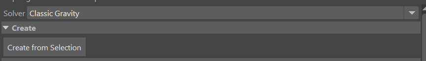

Select the controls and press a direction button in the **Create** section, as for the Classic solver.

Parameters (on the control, keyable), in addition to the Classic ones:

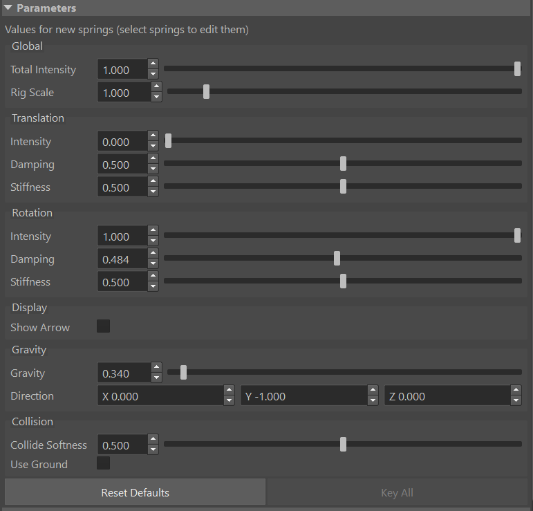

* **Gravity** - How strongly the spring is pulled along the gravity direction. It is scaled with the **Rig Scale**, so the same value gives the same droop on small and big rigs. 0 is a Classic spring; 0.5-1 for light pieces (ears, hair locks); 2-5 for heavy, hanging parts (cables, pouches).
* **Direction** - The gravity direction, in world space. It defaults to the scene down axis (-Y, or -Z in Z-up scenes). Values presets don't change it.
* **Collide Softness** - How softly colliders and the ground push the spring out: 0 hard, 1 no effect.
* **Use Ground** - Keep the spring above the ground. It is turned on when a plane collider is assigned.

Collisions use the **Colliders** section (see `Collision`_):

* **Sphere** colliders push the spring out of them.
* The first assigned **Plane** collider is the ground: the spring stays above its XZ plane, at any height and angle.
* Capsule and mesh colliders are not used by Classic Gravity springs: assigning them is refused with a warning, and their actions are disabled in the section.
* A collider that follows the spring itself (created on its control, or a child of it) is never assigned to that spring: the spring would push its own collider. Put colliders on the body, not on the moving part.

Factory presets: **Gravity Light** and **Gravity Hanging**.

Bone Dynamics (optional)
------------------------

The **Bone Dynamics** solver simulates whole chains of controls with `boneDynamicsNode <https://github.com/akasaki1211/boneDynamicsNode>`_, a free Maya plug-in by Hiroyuki Akasaki (MIT License). It is not shipped with mGear: install it to unlock this solver. Only the compiled plug-in is needed; the Spring Manager does not use the plug-in's Python scripts.

Installing boneDynamicsNode
~~~~~~~~~~~~~~~~~~~~~~~~~~~

1. Download the repository from https://github.com/akasaki1211/boneDynamicsNode (**Code > Download ZIP**) and extract it.
2. Copy the plug-in for your Maya version, ``plug-ins/<MayaVersion>/boneDynamicsNode.mll`` (Maya 2022 to 2027 builds are included), to a plug-ins folder:

   * ``Documents/maya/<MayaVersion>/plug-ins`` (create the ``plug-ins`` folder if needed), one copy per Maya version, or
   * any folder in the ``MAYA_PLUG_IN_PATH`` environment variable (for studio deployments).

3. Start Maya, open **Windows > Settings/Preferences > Plug-in Manager**, find ``boneDynamicsNode.mll`` and check **Loaded** and **Auto load**.
4. Open the Spring Manager: **Bone Dynamics** is now enabled in the **Solver** menu.

Notes:

* The ``scripts`` folder of the repository (``bdn`` package and Attribute Editor template) is **not** needed by mGear. You can install it if you also want to use the plug-in's own tools.
* Windows builds are provided by the author. Linux builds can be compiled from the source but are not tested by the author; there is no macOS build.
* Scenes with Bone Dynamics springs need the plug-in to play. Bake the springs before sending a scene to someone without the plug-in: the Spring Manager lists springs whose plug-in is missing as *plug-in missing*, and they can only be deleted.

Workflow
~~~~~~~~

1. Choose **Bone Dynamics** in the **Solver** menu.
2. Select the **root control** of each chain (a tail root, a hair root, a skirt root...) and press **Create Chain from Selection**. The child controls are found automatically, through ``npo`` groups and other transforms.
3. Play the animation (every frame) and tune the parameters.

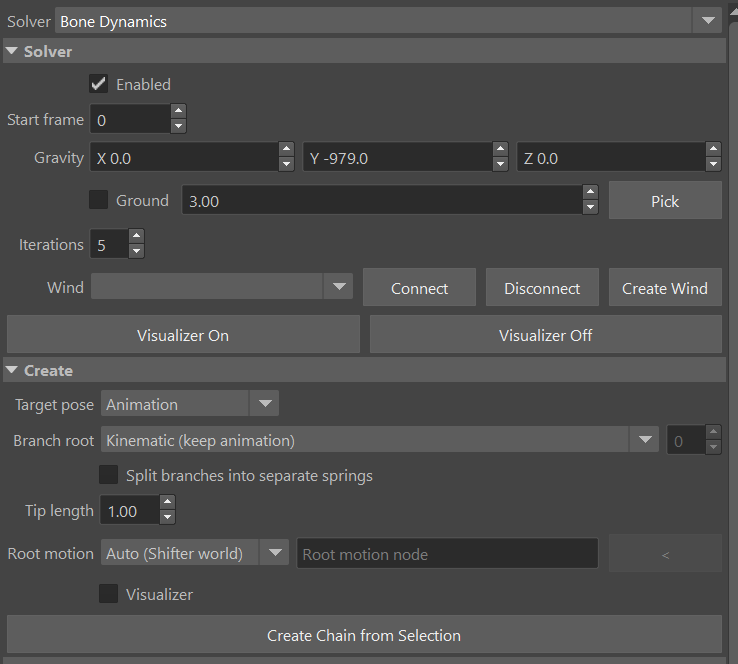

The controls are driven through hidden proxy joints: a *target* chain that follows the animation, and a *sim* chain driven by one boneDynamicsNode per bone. The rig itself is not modified, and deleting the spring gives the animation back to the controls.

Create options:

* **Target pose** - The pose the chain is pulled back to (with **Elasticity**):

  * **Animation** - The animated controls (default).
  * **Target Controls** - Keyable pose controls, shown next to the chain. Animate the pose the chain wants to reach, separately from the base animation.
  * **Captured Pose** - The pose of the controls when the spring is created, or when **Capture Pose** is used.
  * **Blend** - The **Pose Blend** parameter fades from the animation (0) to the captured or controlled pose (1).

  Right-click springs for **Target Pose** to change the mode, **Capture Pose**, or **External Chain from Selection** (select the external nodes in order, then a control of the spring): another chain of the same length drives the target pose. With an elasticity of 0 the target pose has no effect.

* **Branch root** - For a control with several child chains, like a skirt root: **Kinematic** keeps its animation (default), **Average** follows the average of its branches, **Follow primary branch** follows one branch.
* **Split branches into separate springs** - Each branch becomes its own spring, with its own parameters.
* **Tip length** - Length of the tip added after the last control, relative to the last bone, when the control has no child transform.
* **Root motion** - The node whose motion is cancelled from the simulation, so fast character moves don't drag the chains. **Auto** uses the Shifter ``world_ctl`` (or ``global_C0_ctl``) of the rig.
* **Visualizer** - Draw the bones, angle limits and collision volumes in the viewport, as red wireframe capsules along the chain. The visualizer nodes are parented under the spring group.

Parameters (on the root control, keyable):

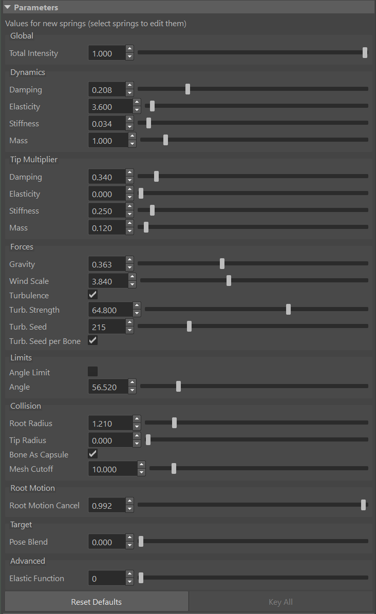

* **Total Intensity** - 0 follows the animation exactly, 1 is the full simulation.
* **Damping**, **Elasticity**, **Stiffness**, **Mass** - The dynamics. Long chains usually need more damping and elasticity.
* **Tip Multiplier** - Multiplies Damping, Elasticity, Stiffness and Mass along the chain: 1 at the root, the multiplier at the tip. For example, an elasticity tip multiplier of 0.5 makes the tip looser.
* **Gravity**, **Wind Scale**, **Turbulence** - Forces. Gravity scales the solver gravity vector. Turbulence adds a random, slowly changing force; **Turb. Seed** picks another random take, and **Turb. Seed per Bone** gives every bone its own seed so the bones and branches do not move in unison.
* **Angle Limit** - Limits the bend from the target pose. It wins over collisions.
* **Root Motion Cancel** - How much of the root motion is cancelled.
* **Pose Blend** - Used by the Blend target mode.
* **Elastic Function** - Advanced: 0 linear, 1 quadratic, 2 cubic.
* **Root Radius**, **Tip Radius**, **Bone As Capsule**, **Mesh Cutoff** - The bone collision volume, see `Collision`_.

Solver section (shared by every Bone Dynamics spring of the scene):

* **Enabled**, **Start frame** (the simulation resets at this frame), **Gravity** (follows the scene up axis and units), **Ground** collision and height (**Pick** sets it from the lowest selected point), **Iterations** (collision accuracy, 0 turns collisions off).
* **Wind** - **Create Wind** makes a wind controller: rotate it to set the direction and key its **strength** (default 100; strong elasticity needs more). **Connect** / **Disconnect** link it to the selected springs.
* **Visualizer On / Off** - For the selected springs, or all of them.
* A banner offers to fix the playback when it is not set to play every frame.

Presets: rig presets save the chains, options and values, the solver settings and the colliders of the springs. **Presets > Apply Solver Settings** and **Presets > Apply Colliders** choose whether applying a rig preset also changes the scene solver and creates its colliders. The Factory library includes values presets for chains: **Chain Hair**, **Chain Tail**, **Chain Cloth Strip** and **Chain Antenna**.

Caveats:

* Play every frame: the simulation depends on the previous frames. Cached playback is turned off by the plug-in while it is enabled.
* Bake before rendering or exporting.
* The plug-in assumes centimeters and the Y-up gravity by default; the Spring Manager sets the gravity from the scene settings.
* Twist is not simulated: it follows the target pose.
* The plug-in uses unregistered node IDs (0x7b0xx). They could clash with in-house plug-ins using the same range.

Collision
~~~~~~~~~

Colliders keep the chains out of the body: hair out of the head and shoulders, skirts out of the legs. They are shared scene objects: one collider can be assigned to many springs, and deleting a spring keeps its colliders. Colliders live under ``spring_colliders_grp`` and follow their *driver* (a joint or control) through a constraint, so the rig is not modified. Move, rotate or resize the collider itself to adjust it; the changes reach the springs live.

The **Colliders** section (Bone Dynamics and Classic Gravity solvers; the table lists the springs of the selected solver, and actions it can't use are disabled):

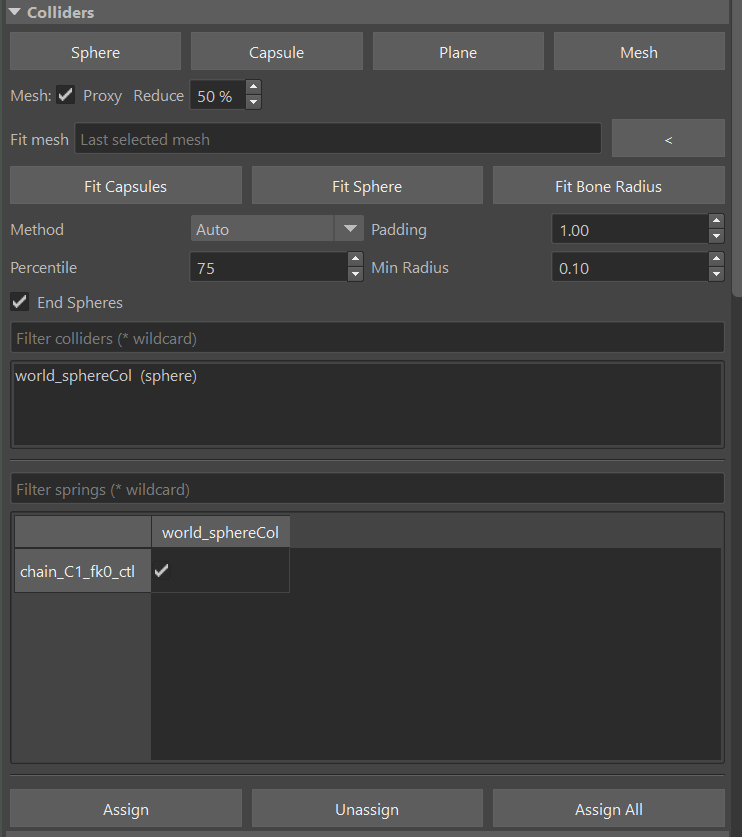

* **Sphere**, **Capsule**, **Plane** (Create frame) - Create a collider on each selected joint or control, or one in world space without selection. Capsules lie along their local Y axis; planes collide with their XZ plane (tilted ground, walls). Without the boneDynamicsNode plug-in, spheres and planes use mGear display shapes (resize a sphere with its **Radius** attribute), and capsules can't be created.
* **Mesh** (experimental) - Collide with the selected mesh. With **Proxy** (recommended), a reduced copy with soft edges follows the mesh through a proximity wrap; the mesh itself is not modified. Mesh collision is slow on dense meshes: a warning shows above 2000 faces.
* **Fit mesh** (Fit frame, with the fit buttons and their options) - The mesh the fit tools measure. Pick it once with **<**, then the selection only names the targets. Empty: the last selected mesh is used.
* **Fit Capsules** - Body colliders: select the joints or controls of one or more chains (spine, neck, arms, legs): one capsule per bone, sized to the mesh. With **End Spheres**, each chain end (head, hands, feet) also gets a sphere. On a spring's controls, the last bone gets a capsule to the chain tip instead, matching the bone volume. Controls are measured by ray casting. Selecting the control of a Bone Dynamics spring uses its simulated joint (hidden in the scene), as if you selected the joint. Colliders on a spring's own joints also set the collision volume of their bone, section by section: the volume other chains collide against is the volume the chain collides with. Resize a capsule to adjust its section. They are never assigned to their own chain.
* **Fit Sphere** - Select vertices (and optionally the driver) for one sphere around them, or joints or controls for a sphere fitted at each.
* **Fit Bone Radius** - For the springs selected in the list (or by their controls), with the Fit mesh set to their mesh (hair cards, a tail): sets the spring **Root Radius** and **Tip Radius** from the mesh thickness, and turns **Bone As Capsule** on. This fits the chain's own volume; **Fit Capsules** builds the body colliders the chains bounce off.
* Fit options: **Method** (**Skin Weights** uses the vertices weighted to each joint, **Ray Cast** works on any mesh, **Auto** uses skin weights when the mesh is skinned to the joints), **Padding** (radius multiplier), **Percentile** (with skin weights: 100 encloses every vertex, 75 ignores the outliers), **Min Radius**.
* Colliders list - Filter it with the field above it (``*`` wildcard), and drag the bar under it to resize it. Right-click to select colliders or their drivers, **Mirror** them to the other side (by the ``L``/``R`` naming; mesh colliders are not mirrored) or **Delete** them.
* Assignment table - One row per spring, one column per collider: check a cell to assign the collider to the spring. The colliders filter also filters the columns, the springs filter above the table filters the rows; drag the bar under it to resize it. **Assign** / **Unassign** act on the selected cells, **Assign All** assigns every collider to every spring.

Bone volume (spring parameters): **Root Radius** and **Tip Radius** are the chain thickness at its root and tip, blended linearly along the chain: quick and good for regular shapes. For complex shapes, fit capsules on the spring controls: each section then uses its own capsule radii, and goes back to the gradient when its capsule is deleted. Each bone collides as a sphere at its end, or as a capsule along the whole bone with **Bone As Capsule** (sphere and capsule colliders only). **Mesh Cutoff** limits the mesh collider search distance.

Tips:

* Start with capsules on the body and a sphere on the head: they are fast and stable. Use mesh colliders only where the shape matters.
* **Iterations** (Solver section) sets the collision accuracy: raise it when chains still pass through colliders, 0 turns collisions off.
* **Angle Limit** wins over collisions.
* Chains don't collide with each other: neighbouring strands of a skirt can cross.

Bake/Clear Spring Nodes
=======================

Bake and clear the springs built **inside Shifter rigs** by the spring components: ``chain_spring_01``, ``chain_spring_gravity_01`` and ``chain_spring_lite_stack_master_01``. For springs added by animators on any control, use the `Spring Manager`_ instead.

These components register their spring nodes in the rig's ``<rig>_PLOT_grp`` set. Each spring node blends between the live spring and its own rotation keys, with the component's **spring intensity** channel: 1 shows the live spring, 0 shows the keys.

* **Bake Spring nodes (Shifter Component)** - Select the rig (or any node of it) and run it. The previous bake is cleared, then the spring rotation is keyed on every frame of the playback range, on every spring node of that rig.
* **Clear Baked Spring nodes (Shifter Component)** - Select the rig and run it: the baked spring keys are deleted and the spring nodes go back to their rest rotation.

**Workflow:**

1. Animate with the springs live (spring intensity 1) and play every frame to check them.
2. **Bake Spring nodes** once the animation is final.
3. Set the spring intensity to 0 on the spring controls to use the baked keys (for example for export or render), or to 1 to see the live spring again.
4. After changing the animation, bake again (it clears the old bake first), or **Clear Baked Spring nodes** to remove it.

**Notes:**

* Only the selected rig is processed. The selection must be the rig root or a node under it.
* Each command is one undo step.
